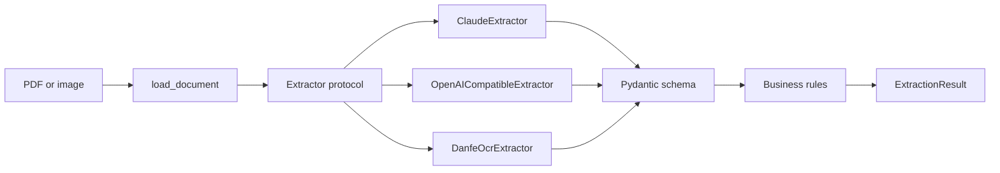

# nf-extractor-ai

[](https://github.com/Filip3Owl/nf-extractor-ai/actions/workflows/ci.yml)
[](pyproject.toml)
[](LICENSE)

AI pipeline that turns unstructured documents into validated, structured data using OCR, layout analysis, and vision LLMs.

**Leia em português:** [README.pt-BR.md](README.pt-BR.md)

The first supported document is the **DANFE**, the printed form of Brazilian electronic invoices (NF-e and NFC-e). A vision LLM reads the PDF or image, and deterministic rules then check the result, so a misread value is flagged instead of silently reaching your systems.

> **Project status: alpha.** The LLM and local OCR extraction, validation rules, evaluation harness and CLI are implemented. Tests simulate the LLM APIs, so no LLM has been measured yet, and accuracy has not been measured on real documents. See the [roadmap](#roadmap).

## Why validation matters

An LLM can return a well-formed answer that is wrong. A DANFE has built-in redundancy that can expose this, and the pipeline checks it without relying on the model:

| Check | Example of what it catches | Severity |
|---|---|---|
| Access key check digit | A misread digit in the 44-character key | Error |
| CNPJ and CPF check digits, including the [alphanumeric CNPJ](docs/architecture.md#alphanumeric-cnpj) | A wrong issuer or recipient identifier | Error |
| Printed fields against the access key | An invoice number that differs from the one in the key | Error |
| Quantity × unit price against item total | A misread item value | Warning |
| Sum of items against products total | A line that was skipped | Warning |
| Invoice total against its components | A misread total | Warning |

Errors mark rules that a genuine invoice always satisfies. Warnings mark rules with legitimate exceptions, so they suggest human review.

## Quick start

Requirements: [uv](https://docs.astral.sh/uv/) and a [Claude API key](https://platform.claude.com/).

```bash
git clone https://github.com/Filip3Owl/nf-extractor-ai.git
cd nf-extractor-ai
uv sync

cp .env.example .env   # then add your ANTHROPIC_API_KEY

uv run nf-extractor extract path/to/danfe.pdf --output result.json
```

Each extraction makes one paid API call, and its token usage is recorded in the output.

### Choose an extractor

| `--extractor` | Cost | Documents leave your machine | Setup |
|---|---|---|---|
| `claude` (default) | Paid | Yes | `ANTHROPIC_API_KEY` |
| `gemini` | Free tier, with limits | Yes | `GEMINI_API_KEY` and `uv sync --extra vision` |
| `groq` | Free tier, with limits | Yes | `GROQ_API_KEY` and `uv sync --extra vision` |
| `openrouter` | Free models, with limits | Yes | `OPENROUTER_API_KEY` and `uv sync --extra vision` |
| `custom` | Depends on the API | Depends on the API | `NF_EXTRACTOR_LLM_BASE_URL`, `NF_EXTRACTOR_LLM_MODEL` and `uv sync --extra vision` |
| `ocr` | Free | No | `uv sync --extra ocr` |

The `vision` extra is needed only for PDFs. Availability on free tiers varies by provider and changes often.

To measure an extractor on fictional invoices:

```bash
uv sync --all-extras
uv run nf-extractor eval generate --count 5
uv run nf-extractor eval run --extractor ocr
```

### Output

The values below are illustrative:

```json
{
  "document_name": "danfe.pdf",
  "document_type": "nfe",
  "model": "claude-opus-5-5",
  "usage": { "input_tokens": 3120, "output_tokens": 845 },
  "data": {
    "chave_acesso": "35261011222333000181550010000001231123456783",
    "numero": "123",
    "data_emissao": "2026-10-15",
    "emitente": { "nome": "Empresa Exemplo LTDA", "documento": "11.222.333/0001-81", "...": "..." },
    "itens": ["..."],
    "totais": { "valor_total_nota": "130.00", "...": "..." }
  },
  "issues": [],
  "is_valid": true
}
```

Monetary values are strings so they can be read as exact decimals. Any value that the model could not read is `null`.

### Exit codes

| Code | Meaning |
|---|---|
| `0` | Extracted and valid. Warnings may be printed to standard error. |
| `1` | Extraction failed, so there is no output. |
| `2` | The command was used incorrectly. |
| `3` | Extracted, but validation found errors. The output is still written for review. |

### Use it as a library

```python
from pathlib import Path

from nf_extractor.core.pipeline import ExtractionPipeline
from nf_extractor.document_types.nfe import NFE
from nf_extractor.extractors.claude import ClaudeExtractor

pipeline = ExtractionPipeline(ClaudeExtractor())
result = pipeline.run(Path("danfe.pdf"), NFE)

if result.is_valid:
    print(result.data.totais)
else:
    print(result.issues)
```

## Configuration

Settings come from environment variables or a `.env` file.

| Variable | Default | Description |
|---|---|---|
| `ANTHROPIC_API_KEY` | none | API key for Claude. |
| `GEMINI_API_KEY`, `GROQ_API_KEY`, `OPENROUTER_API_KEY` | none | API key for each public LLM API. |
| `NF_EXTRACTOR_MODEL` | `claude-opus-5-5` | Claude model used for extraction. |
| `NF_EXTRACTOR_EFFORT` | `high` | Claude reasoning effort: `low`, `medium`, `high`, `xhigh` or `max`. |
| `NF_EXTRACTOR_MAX_TOKENS` | `16000` | Response size limit. Raise it for very long invoices. |
| `NF_EXTRACTOR_LLM_MODEL` | Per provider | Replaces the default model of `gemini`, `groq` or `openrouter`. Required for `custom`. |
| `NF_EXTRACTOR_LLM_BASE_URL` | none | Address of the API used by `custom`, without `/chat/completions`. |
| `NF_EXTRACTOR_LLM_API_KEY` | none | API key used by `custom`. |

## Data privacy

Invoices contain personal and commercial data, so they may be subject to Brazil's LGPD.

- **Except with `ocr`, documents are sent to an external API for processing.** Make sure you have a legal basis for sharing them and that this suits your data retention requirements.
- **Do not send real invoices to free tiers.** Providers may use what they receive there. For example, Google's [Gemini API terms](https://ai.google.dev/gemini-api/terms) allow it to use that content to improve its products and allow human review, and they ask users not to submit personal information. Use free tiers with synthetic documents, and check each provider's terms.
- `Document` representations and schema validation errors leave out document contents, so they are safer to log.
- `.gitignore` excludes PDFs, images and `data/`. Tests use synthetic data only.
- Documents are treated as untrusted input. The model is told not to follow instructions found inside them, and the deterministic validators act as an independent check. This reduces the risk of prompt injection but cannot eliminate it, so review results before using them in automated decisions.

## Architecture



The core knows nothing about invoices or about any LLM provider. Both plug in from the outside, so future projects can reuse it:

- **A new document type**, such as a CT-e, a boleto or a contract, is a schema, instructions and validators. See [Adding a document type](docs/adding-a-document-type.md).
- **A new backend**, such as OCR or another LLM provider, is a class that implements `Extractor`.

Read more in the [architecture guide](docs/architecture.md) and the [decision records](docs/adr/).

## Roadmap

- [x] Generic pipeline, NF-e schema, validation rules, Claude extractor and CLI
- [x] Synthetic DANFE dataset and an evaluation harness with per-field accuracy
- [x] OCR and layout analysis backend, to compare accuracy and cost against the LLM
- [x] Backend for public LLM APIs: Gemini, Groq, OpenRouter and other compatible APIs
- [ ] First evaluation of the LLM backends, which needs API keys
- [ ] NF-e XML parser, to provide ground truth for evaluation
- [ ] More image preprocessing with OpenCV: denoising and cropping (deskewing is done)
- [ ] Batch processing and a FastAPI service with Docker
- [ ] Web demo on Hugging Face Spaces
- [ ] More document types: CT-e, NFS-e and boleto

## Development

```bash
uv sync
uv run pre-commit install --hook-type pre-commit --hook-type commit-msg

uv run pytest          # tests with coverage
uv run ruff check .    # lint
uv run ruff format .   # format
uv run mypy            # type check
```

Tests never call the real API or spend credits. See [CONTRIBUTING.md](CONTRIBUTING.md) for the branching and commit conventions, and [CHANGELOG.md](CHANGELOG.md) for release history.

## License

[MIT](LICENSE)
