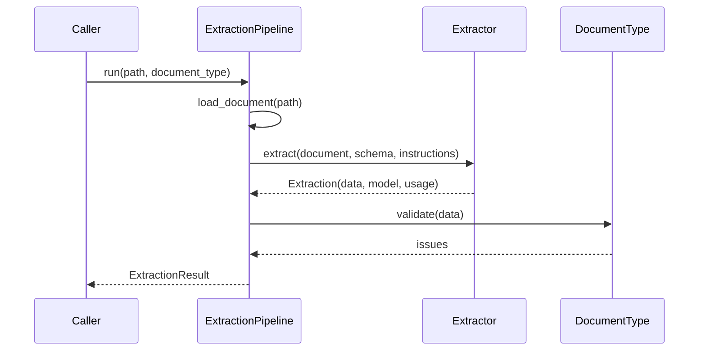

# Architecture

## Goals

1. **Trustworthy output.** An LLM can be confidently wrong, so its output is always checked by rules it does not control.
2. **Reuse in future projects.** New document types and new extraction technologies should not require changes to the core.
3. **Measurable and replaceable backends.** The LLM is one implementation of an interface, so it can be compared against OCR or replaced.

## Package layout

```text
src/nf_extractor/
├── core/                 # Generic: knows nothing about invoices or providers
│   ├── document.py       # Document, and loading files from disk
│   ├── document_type.py  # DocumentType and DocumentTypeRegistry
│   ├── pipeline.py       # ExtractionPipeline: load, extract, validate
│   ├── ports.py          # The Extractor protocol
│   └── result.py         # ExtractionResult, ValidationIssue and Severity
├── document_types/       # One subpackage per kind of document
│   └── nfe/              # Schema, instructions and validators for NF-e and NFC-e
├── evaluation/           # Synthetic documents, metrics and the evaluation harness
├── extractors/           # Implementations of the Extractor protocol
│   ├── claude.py
│   ├── common.py         # Prompt and response handling shared by the LLM extractors
│   ├── danfe_ocr.py      # Local OCR followed by layout rules
│   └── openai_compatible.py # Gemini, Groq, OpenRouter and other chat completions APIs
├── validators/           # Rules shared between document types
│   └── br_identifiers.py # CPF, CNPJ and access keys
├── cli.py                # Command-line interface
├── config.py             # Settings from the environment
└── errors.py             # Exception hierarchy
```

Dependencies point inward. `core` imports nothing from `document_types`, `extractors` or `cli`, which is what allows it to be reused.

## Flow



## Handling failures

There are two distinct kinds of failure, and they are handled differently.

| Failure | Example | Behavior |
|---|---|---|
| No usable output | Unreadable file, API error, refusal or truncated response | Raises a subclass of `NFExtractorError` |
| Output with problems | Invalid check digit or totals that do not add up | Returns the data, with entries in `issues` |

Keeping the data in the second case lets a person correct the one bad field instead of retyping the whole invoice. For the same reason, the schema accepts identifiers as plain strings: rejecting them there would discard an otherwise good extraction.

## Reading the model's response

`ClaudeExtractor` checks `stop_reason` first, then validates the JSON with Pydantic. This gives refusals and truncated responses their own exceptions and an actionable message. See [ADR 0002](adr/0002-claude-structured-outputs.md).

## Number handling

Monetary values use `Decimal` because binary floats cannot represent amounts such as `0.10` exactly. They are requested from the model as strings for the same reason, and appear as strings in the JSON output.

## Alphanumeric CNPJ

CNPJs issued from July 2026 may contain letters in their first 12 positions (IN RFB 2.229/2024). [Nota Técnica Conjunta 2025.001](https://www.nfe.fazenda.gov.br/) applies this to fiscal documents, so access keys follow the pattern `[0-9]{6}[A-Z0-9]{12}[0-9]{26}`.

The modulo 11 calculation is unchanged except that each character counts as its ASCII code minus 48. Digits keep their usual values, so `br_identifiers.py` uses one routine for both formats.

## Design choices for scale

- **Stateless processing.** The pipeline holds no per-document state, so one instance can process many documents, and workers can be added behind a queue.
- **Protocols at the boundaries.** A batch runner, an HTTP service or an evaluation harness can call `ExtractionPipeline` without changing it.
- **Usage in every result.** Token counts make cost per document measurable from the start.
